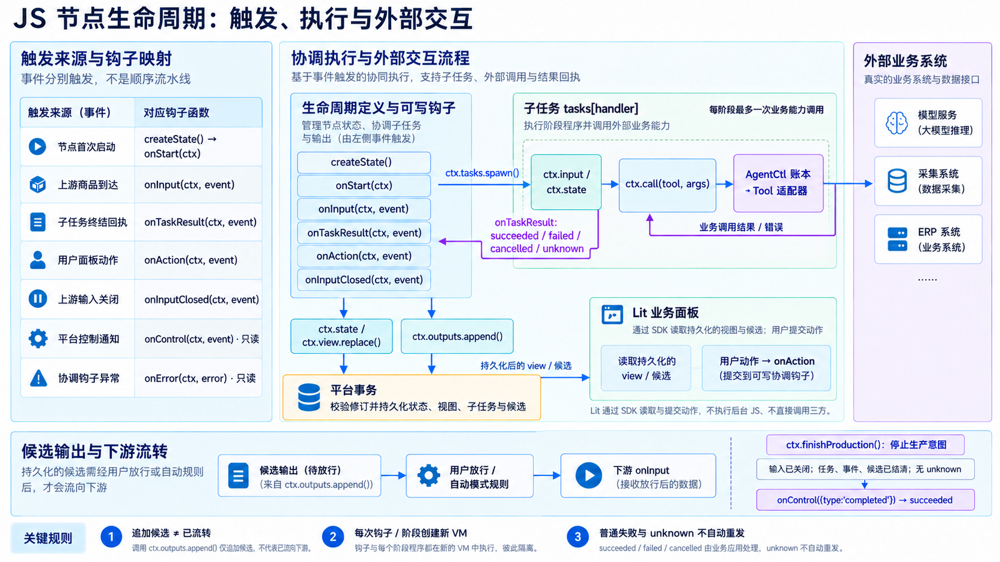

# 魔方节点工程模板

一个 npm workspace 同时维护 Lit 设置面板、Lit 业务面板和 Goja JavaScript 执行程序。组件、宿主接线和类型共用，发布产物保持独立。

公开模板仓库：[xiaojiecode/mofang-node-workspace-template](https://github.com/xiaojiecode/mofang-node-workspace-template)。可通过 GitHub 的 **Use this template** 创建自己的仓库；也可以按下面的命令初始化只包含一个起始节点的新项目。

## 从空目录开始

需要 Node.js 22.12+、npm 和 Git。完整 Goja 验证还需要 Go 1.26.5+；只写面板和类型检查无需 Go。

```sh
git clone https://github.com/xiaojiecode/mofang-node-workspace-template.git
cd mofang-node-workspace-template

# 在模板仓库内初始化新仓库（不会覆盖非空目录）
node tooling/init/project.mjs --dir ../my-nodes --name my-nodes --interface lifecycle
cd ../my-nodes
npm ci
npm run dev
```

Vite 默认地址为 http://127.0.0.1:5188，提供双面板、草稿回写、只读、空结果、错误和 SDK 更换场景。页面明确使用本地 fixture；它不调用真实业务或保存目录。

```sh
npm run node:new -- --code my-node --interface lifecycle
npm run typecheck
npm run build
npm run verify
npm test

# 使用已安装 Chrome；macOS 示例，Linux/Windows 填实际可执行文件路径
MF_CHROME_PATH="/Applications/Google Chrome.app/Contents/MacOS/Google Chrome" npm run test:browser
# 或先安装 Playwright Chromium，浏览器下载缓存可通过 PLAYWRIGHT_BROWSERS_PATH 指定
npx playwright install chromium
npm run test:browser

npm run trial -- --node pass-through
npm run check
```

`check` 运行类型检查、打包、产物检查、回归、浏览器测试和 Goja fixture。缺少 Chrome/Chromium 或 Go 会明确失败。可设置 `MF_CACHE_DIR` 指定 Vite、验证日志、截图及 Go 缓存；安装缓存使用 npm 的 `NPM_CONFIG_CACHE`。不要把缓存提交到 Git。

## 目录和复用边界

| 目录 | 职责 |
| --- | --- |
| `packages/contracts` | 完整浏览器 SDK/宿主、Goja 作者接口、10 类系统 Schema 及生成业务类型 |
| `packages/lit-ui` | 通用受控表单、状态/错误/空态、商品展示和主题样式 |
| `packages/lit-host` | 注入属性、SDK/目标变更后的订阅重绑、卸载清理 |
| `nodes/<code>/settings` | 本节点设置面板 |
| `nodes/<code>/business` | 本节点业务面板；stages 读正式输出，lifecycle 读 nodeFlow |
| `nodes/<code>/executor` | 本节点后台执行程序 |
| `nodes/<code>/contract.ts` | 本节点 Input、Output、辅助设置与双 Schema |
| `nodes/<code>/shared` | 仅本节点复用的纯逻辑 |
| `nodes/<code>/fixtures` | 预览输入和 Goja 断言；修改业务后同步调整 |
| `apps/playground` | Vite 开发宿主；禁止进入发布产物 |
| `tooling` | 初始化、构建、契约同步和验证 |

`lit-ui` 组件只接收数据与回调，不拿 SDK。它们用 Lit 模板函数和 CSS 复用，不注册全局固定标签。设置值始终来自宿主，使用官方 `live` 指令处理归一化和拒绝输入后的值恢复。需要自定义元素时，必须为多节点和历史修订同时加载设计注册隔离，不能用“已注册就跳过”复用另一版本的类。

`lit-host` 不创建 SDK、HTTP transport 或 SSE；只消费宿主实例。界面操作回调 `ui.onSelectTask` 接受 `{taskId, nodeRunId?}`。设置编辑走 `settings.onFieldChange`，最终保存由外层宿主负责。

公共组件在编译时分别内联进双面板，最终只保留 `lit` 运行时导入。官方 Lit 指令的代码可以内联，所引用的核心映射到宿主 `lit`，不打入第二份核心。面板根类只导出，由平台按产物哈希注册。

官方指令必须匹配宿主的 Lit 构建模式：`npm run build` 默认生成生产产物，用于已部署的生产客户端；本地 Vite 开发宿主使用 `npm run build:dev`。两者都固定 Lit 3.3.3。manifest 记录模式，产物预览会加载匹配的核心；源码预览使用开发版。不要把生产指令与开发核心混用。组件、类型和业务逻辑共用，模式只控制编译条件。


## 代码格式、注释与构建报告

`npm run lint` 检查代码格式，`npm run lint:fix`（或 `npm run format`）自动修复。使用空格缩进，每级 4 格，赋值、比较及其它二元运算符两侧留空格；`.editorconfig` 与 Prettier 保持一致。生成的 SDK 声明、系统 Schema 和类型快照沿来源维护，不在格式化时改写其内容。

生命周期、阶段执行、页面数据程序与通用函数含中文说明，覆盖调用时机、参数、返回和副作用限制。`export default` 前保留 `// noinspection JSUnusedGlobalSymbols`，供 IDE 识别由构建器或宿主消费的入口。脚手架源码在 `tooling/init/templates/`，初始化项目和 `node:new` 均从这些文件生成；修改模板后需运行对应脚手架检查。

正式 `npm run build` 使用 esbuild 的语法、标识符和空白压缩、tree shaking 与 UTF-8 输出；保留属性名、函数/类名及宿主 ABI，Goja 仍降级到 ES2016。源码中文注释只用于开发，不进入发布产物。`npm run build:dev` 保留可读代码，并匹配开发版 Lit 核心。

每个产物输出编译后大小、gzip 参考大小与编译耗时，结尾汇总节点数、产物数、总体积和总耗时。`dist/<code>/manifest.json` 保存字节数、来源字节数、gzip 大小、摘要及耗时；`dist/build-report.json` 保存整次汇总。gzip 使用 level 9 独立估算，不代表宿主实际传输方式；源字节数是该入口依赖文件大小之和，不能当作未经压缩的 bundle 大小。

## 类型与新 TypeScript 语法

锁定 TypeScript 7.0.2、Vite 8.3.5 和 esbuild 0.28.2；Lit 3.3.3 与当前宿主一致。安装使用 lockfile，不在每次安装时浮动升级。

```ts
import type { Product } from '@mofang/contracts/business'
import type { MofangSDK, PanelProps } from '@mofang/contracts/browser'
import type { LifecycleProgram, StageContext, MainContext } from '@mofang/contracts/goja'
import type { PageProgramContext } from '@mofang/contracts/page-program'
import { HostPanel } from '@mofang/lit-host'
import { productSummary, textField, panelStyles } from '@mofang/lit-ui'
```

这些 contracts 入口只提供类型，不能用它们创建运行时 SDK。Product 来自完整内置 Schema，包含 collection、basic、images、videos、skus、attributes、references；本节点辅助字段和报告放在根部，不改写系统类型。

浏览器、Goja、页面数据程序分别使用 tsconfig。Goja 没有 DOM、Node.js、网络或定时器类型；标准库仅开放选定能力。页面数据程序也不开放 DOM，全局时钟、网络和随机数由产物检查继续阻止。该项目跳过依赖声明内部检查，因为共享浏览器声明图包含 AbortSignal；浏览器项目会完整检查同一套声明。

可以使用 `satisfies`、类型导入、泛型和 `async/await`。后台产物目标为 ES2016，async 方法会被转换成普通函数返回 Promise，以通过当前平台的阶段声明检查。语法降级不提供新运行时 API；例如不能据此使用 fetch、定时器或所有 ESNext 标准库。

类型不能表达 JSON Schema 的所有数值范围、格式和跨字段约束。产物验证使用自带 Schema，最终仍由平台验证冻结契约。浏览器预览数据和 SDK 替身不是服务端权限或业务链路验证。

## 运行入口与生命周期

`node:new` 支持 `main`、`stages`、`lifecycle`、`panels`。其中 `panels` 用于只开发现有 Agent/Go 节点的两套页面。

生命周期的启动入口使用已有 `onStart(ctx)`。节点会话首次激活时，平台依次处理 `createState()` 与 `onStart(ctx)`；页面重绘、SDK 刷新、每个商品到达均不重新触发启动。工作流新运行会创建新会话；被跳过而未激活的节点不触发。Node Lab 试运行采用同样的启动顺序。

生成的生命周期示例在 onStart 写入 `started` 状态和 view；onInput 派发子任务；onTaskResult 追加完整候选并保留 inputRefs。候选追加不等于已流转，finishProduction 也不等于节点已经完成。计数仅供样例展示，平台任务 summary 和候选状态才是当前执行事实。

单次 main 程序中的终结方法只登记意图，不会中断 JavaScript，必须显式 `return ctx.failNode(...)` 或 `return ctx.complete(...)`。具名阶段的终结方法由宿主中断，使用独立 StageContext；不要交换这两种上下文类型。类型目录也明确区分可写协调钩子与只读 onControl/onError。



图为内置生图生成的说明图；准确字段以 types、同步来源与平台源码为准。

## 构建与平台验证

`dist/<code>/` 的产物：

- `settings.js`：设置 viewSource。
- `business.js`：业务 viewSource。
- `pageProgram.js`：业务页面必需的 prepareInput ABI；默认返回需要宿主准备商品，不伪造来源凭据。
- `program.js`：Goja 单文件程序，保留平台要求的 program 绑定。
- `node.json`：新建 JavaScript 目录请求体；更新时需重新读取目录身份和修订。
- `manifest.json`：本地检查用的产物列表、大小与摘要，不是平台请求体。

`node.ts` 也是本地配置，不直接回传给平台。构建和初始化不执行保存、发布、实例升级或真实 Tool 调用。

`trial` / `verify:goja` 在与平台同版本的 Goja 引擎中运行本节点 fixture，检查输入、输出和显式钩子断言。它不模拟生产调度、账本、权限、并发或跨进程恢复。改业务后需要同步 fixtures，禁止修改断言来掩盖行为变化。

维护者还可以使用当前平台真实页面编译器、jsprogram 加载器及每阶段/钩子新 VM 的行为：

```sh
npm run verify:platform -- --workspace /path/to/mofangv6
```

该命令用 Go overlay 加载验证代码，不改平台源码，不启动服务，也不连接数据库。

## 契约更新

仓库自带完整声明与 Schema 快照，普通开发不依赖魔方工作区。维护者显式同步：

```sh
npm run check:contracts -- --workspace /path/to/mofangv6
npm run sync:contracts -- --workspace /path/to/mofangv6
npm run check
npm run verify:platform -- --workspace /path/to/mofangv6
```

浏览器声明自动导出，业务类型从 Schema 生成。Goja 作者 API 是对当前动态宿主实现的手工类型描述，需要随来源变化复核，并通过运行验证。provenance 保存源码内容哈希，不用一个可能包含未提交改动的 Git SHA 代替来源证据。
